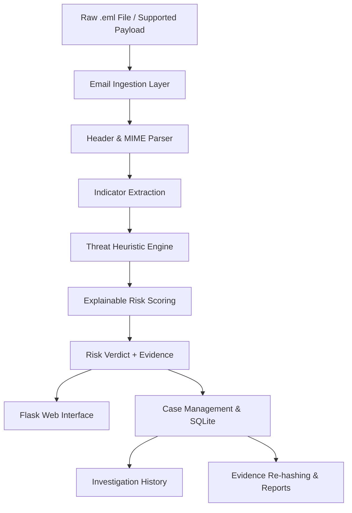

# 🛡️ SentinelTrace AI
### Understand the Risk Before the Click.

**Explainable Email Forensics · Business Email Compromise (BEC) Defense · Offline-First Security · Privacy by Design**

<p align="center">
  
  
  
  
  
  
</p>

<p align="center">
  <strong>Don't just detect suspicious emails. Explain why they are dangerous.</strong>
</p>

---

## 🚨 The Problem: One Email Can Compromise an Entire Organization

Modern cyberattacks don't always begin with malware. Sometimes, they begin with a convincing email.

A message that appears to come from a CEO, a trusted vendor, a bank, or an internal finance team can trick an employee into transferring money, revealing credentials, or opening a malicious attachment.

**Business Email Compromise (BEC)** and phishing attacks exploit trust, urgency, and subtle identity deception. A message may look legitimate while its sender identity, reply destination, authentication results, or embedded links tell a different story.

Traditional security tools may present a simple warning without giving investigators enough context to understand the underlying evidence. Cloud-based analysis can also be unsuitable when emails contain confidential business information.

### The challenge

- 🔎 Detect suspicious signals hidden inside email headers and MIME structures.
- 🎭 Identify executive impersonation, lookalike domains, and misleading sender identities.
- 🔗 Inspect suspicious URLs, deceptive link text, and attachment fingerprints.
- 🧠 Turn multiple technical indicators into an understandable risk assessment.
- 🔒 Analyze sensitive email evidence without requiring external API calls for core analysis.
- 📁 Preserve investigation history and support repeatable forensic review.

## 💡 Our Solution

**SentinelTrace AI is an explainable, offline-first email forensic and fraud intelligence platform.**

It ingests raw `.eml` files or supported email payloads, extracts relevant evidence, evaluates suspicious indicators, and produces a risk verdict with human-readable explanations.

Instead of simply saying *"This email is dangerous,"* SentinelTrace aims to answer:

- What makes this email suspicious?
- Which technical indicators contributed to the risk score?
- Is the sender's identity consistent with the reply destination?
- Are there suspicious links, authentication results, or attachment indicators?
- What evidence should an analyst investigate next?

### Our approach

**Ingest → Parse → Inspect → Score → Explain → Investigate → Audit**

The result is a security workflow designed to make email threat analysis more transparent, privacy-conscious, and actionable.

---

## ✨ Key Features

### 1. 🔍 Deep Email Header & MIME Forensics

Inspect the underlying structure of an email rather than relying only on its visible message body.

- Parse raw email headers and message content.
- Extract sender, recipient, subject, and reply-related metadata.
- Inspect available SPF, DKIM, and DMARC authentication results.
- Examine MIME parts and supported attachment metadata.
- Identify inconsistencies between the apparent sender identity and available message evidence.

**Why it matters:** Email headers often contain clues that are invisible to the recipient reading the message in their inbox.

> Authentication results found in a message are evidence to inspect, not automatic proof that the message or sender is trustworthy.

### 2. 🎭 Executive Impersonation & Domain Intelligence

Detect suspicious identity patterns commonly associated with social engineering.

- Flag suspicious display-name and sender-address combinations.
- Identify Reply-To mismatches that warrant investigation.
- Detect lookalike domains and common typosquatting patterns.
- Inspect internationalized or punycode domain representations.
- Highlight suspicious domain variations for analyst review.

**Example scenario:** A message displays the name of a finance executive, but the sender address uses a lookalike domain. SentinelTrace can surface the mismatch as an explainable warning.

### 3. 🧠 Explainable Risk Scoring

Security decisions should be understandable, not mysterious.

SentinelTrace uses a noisy-OR-style scoring model to combine individual risk indicators:

\[
S=1-\prod_{i=1}^{n}(1-w_i)
\]

Where:

- \(S\) represents the combined risk score.
- \(w_i\) represents the normalized contribution of an individual indicator.
- \(n\) represents the number of evaluated indicators.

For a percentage display:

\[
\text{Risk Score}=100\times S
\]

Each indicator can contribute to the combined score while preserving a reason that an analyst can inspect.

**Example:** A suspicious sender domain, a Reply-To mismatch, and a misleading URL may collectively produce a higher risk assessment than any one signal alone.

The scoring model is a heuristic prioritization mechanism, not a calibrated probability of compromise. Its thresholds and weights should be evaluated against representative test data.

### 4. 🔗 URL & Attachment Inspection

Email threats frequently hide behind links and attachments.

SentinelTrace is designed to inspect supported indicators such as:

- IP-address-based URL hosts.
- Known URL-shortening patterns.
- Punycode and suspicious domain representations.
- Differences between displayed link text and the actual destination.
- Attachment metadata and file hashes.
- Matches against an available local attachment-hash reference set, where configured.

**Privacy advantage:** Core inspection can work without uploading email contents to an external scanning service.

*Note: Static URL and hash inspection does not guarantee that a destination or attachment is safe. The engine should not automatically open suspicious links or execute untrusted files.*

### 5. 🔒 Offline-First, Privacy-Conscious Architecture

Sensitive emails may contain customer information, internal financial discussions, confidential documents, or personal data.

SentinelTrace is designed to perform its core analysis locally without requiring external network calls.

- No external threat-intelligence API is required for core analysis.
- Email evidence can remain within the deployment environment.
- Local database storage supports investigation records.
- Analysis can continue without relying on a third-party analysis service.

**Important distinction:** Offline-first describes the core analysis path. Deployment hosting, browser assets, optional integrations, or external links may still use network connectivity. Review the actual deployment configuration before making a strict zero-network claim.

### 6. 📊 Investigation & Case Management

Move beyond a one-time scan toward a structured investigation workflow.

- Store supported investigation records in SQLite.
- Maintain case notes and investigation context.
- Revisit previously analyzed cases.
- Generate exportable reports where supported.
- Rehash stored evidence to detect changes.
- Maintain a clearer trail of investigative activity.

**Goal:** Make findings easier to review, communicate, and reproduce.

### 7. 🧾 Evidence Integrity & Audit Support

Security findings are more useful when investigators can examine the evidence behind them.

SentinelTrace incorporates evidence re-hashing and case-oriented storage to support integrity checks.

Hash verification can help identify changes to the bytes being checked. It does not, by itself, establish who originally created the evidence, prove the authenticity of an email, or guarantee a tamper-proof audit trail.

### 8. ⚡ Lightweight, Practical Deployment

Built using a familiar Python web stack, SentinelTrace is designed to be approachable for local development and deployment.

- Python-based analysis engine.
- Flask web application.
- HTML, CSS, JavaScript, and Jinja2 interface.
- SQLite-backed local persistence.
- Gunicorn support for compatible deployments.
- Docker and Render Blueprint support where configured.

---

## 🏗️ System Architecture

The platform separates email ingestion, analysis, scoring, presentation, and investigation storage into logical stages.



### Architecture components

| Component | Responsibility |
|---|---|
| Email ingestion | Accepts supported email inputs |
| Header and MIME parser | Extracts message structure and metadata |
| Indicator extraction | Identifies relevant sender, authentication, URL, and attachment signals |
| Heuristic engine | Evaluates supported suspicious patterns |
| Risk scorer | Combines normalized risk contributions |
| Explanation layer | Presents risk factors in human-readable form |
| Flask interface | Provides the web-based analysis workflow |
| SQLite persistence | Stores supported cases and investigation information |
| Evidence integrity layer | Rehashes evidence for comparison and integrity checks |

### Design principle

**Separate evidence extraction from risk interpretation.**

This makes the system easier to test, debug, extend, and explain to analysts.

---

## 🔬 How SentinelTrace Analyzes an Email

Consider a hypothetical email that claims to come from a company's finance director and requests an urgent payment.

### Step 1 — Ingest

The investigator submits the raw email file.

### Step 2 — Extract evidence

The parser examines available headers, sender information, authentication results, message structure, URLs, and attachment metadata.

### Step 3 — Identify suspicious indicators

The engine checks for supported signals, such as:

- A potentially deceptive sender domain.
- A mismatch between the sender and Reply-To address.
- Suspicious destination URLs.
- Authentication failures reported in the message.
- Attachment hashes that match a configured local reference set.

### Step 4 — Calculate risk

The engine combines applicable indicator weights using the configured scoring model.

### Step 5 — Explain the verdict

The interface presents the risk assessment and its contributing evidence so that an investigator can understand why the message was flagged.

### Step 6 — Record the investigation

Where enabled, the investigator saves the case, adds notes, and retains the supported evidence and report information.

**The result:** A reviewable assessment rather than an unexplained binary warning.

---

## 🎯 Example Threat Scenarios

These scenarios illustrate intended behavior; they are not claims of measured detection accuracy.

| Threat scenario | Signals to investigate | Intended outcome |
|---|---|---|
| CEO impersonation | Display name and sender-address inconsistency | Highlight identity mismatch |
| Vendor payment fraud | Lookalike sender domain and suspicious reply destination | Raise a contextual warning |
| Credential phishing | Misleading link text and suspicious destination | Surface URL indicators |
| Authentication anomaly | Available SPF, DKIM, or DMARC failure results | Explain the reported authentication signals |
| Suspicious attachment | File metadata and known local hash matches | Highlight matching evidence |
| Unusual email structure | Header and MIME inconsistencies | Flag patterns requiring manual review |

A single suspicious signal is not conclusive proof of malicious intent. Legitimate emails can also contain unusual formatting, failed authentication, or forwarding-related discrepancies.

---

## 📈 Risk Interpretation

The exact thresholds depend on the configured scoring policy.

| Risk band | Suggested interpretation |
|---|---|
| Low | Few or weak suspicious indicators; review context as appropriate |
| Moderate | Multiple or meaningful signals warrant closer inspection |
| High | Stronger combination of suspicious signals; prioritize investigation |
| Critical | Very high heuristic score; prioritize urgent human review |

These are suggested interpretations, not claims about the application's current default thresholds. Use the actual configured bands in the interface and documentation.

**A high risk score is a triage signal, not proof of fraud. A low score is not a guarantee of safety.**

---

## 🛠️ Technology Stack

| Layer | Technologies |
|---|---|
| Programming language | Python 3.10+ |
| Web framework | Flask |
| Application server | Gunicorn |
| Database | SQLite |
| Data access | SQL DAO patterns |
| Frontend | HTML5, CSS3, JavaScript |
| Templates | Jinja2 |
| Containerization | Docker |
| Deployment support | Render Blueprint configuration |

### Why this stack?

- **Python:** A practical foundation for email parsing, security heuristics, and automated testing.
- **Flask:** A lightweight framework for exposing analysis workflows through a web interface.
- **SQLite:** Simple local persistence without requiring a separate database server.
- **Jinja2 and JavaScript:** A familiar way to build an interactive investigation interface.
- **Docker:** A reproducible environment when a Docker configuration is provided.

---

## 🚀 Getting Started

### Prerequisites

- Python 3.10 or later.
- Git.
- A terminal or command prompt.
- A supported operating system.

### 1. Clone the repository

```bash
git clone https://github.com/HackIndiaXYZ/hackindia-ai-cybertech-hackathon-2026-logic-flux.git sentineltrace-ai
cd sentineltrace-ai
```

### 2. Create a virtual environment

**Windows — PowerShell**

```powershell
python -m venv .venv
.venv\Scripts\Activate.ps1
```

If PowerShell blocks script execution, activate the environment using Command Prompt instead:

```bat
.venv\Scripts\activate.bat
```

**Linux / macOS**

```bash
python3 -m venv .venv
source .venv/bin/activate
```

### 3. Install dependencies

```bash
python -m pip install --upgrade pip
pip install -r requirements.txt
```

### 4. Run the application

```bash
python wsgi.py
```

Open the local URL printed by the application in your browser. If the application does not print one, check its Flask startup configuration.

**Note:** The commands assume that `requirements.txt` and `wsgi.py` exist at the repository root and that `wsgi.py` starts the application. Adjust the commands if your actual repository structure differs.

### Optional: Run with Gunicorn

If the application exposes a WSGI object named `app` in `wsgi.py`, a compatible deployment can use:

```bash
gunicorn wsgi:app
```

Confirm the actual WSGI module and object name before using this command.

---

## 🧪 Testing & Validation

Cybersecurity software must be evaluated on more than whether the interface loads.

A useful validation plan should include the following cases:

- [ ] Parse a valid `.eml` message.
- [ ] Handle malformed or incomplete email input safely.
- [ ] Process missing or incomplete authentication headers.
- [ ] Detect configured sender and Reply-To mismatch patterns.
- [ ] Test suspicious and ordinary URL representations.
- [ ] Verify attachment-hash matching against known test fixtures.
- [ ] Confirm that the risk score remains within its documented range.
- [ ] Verify that the explanation matches the indicators contributing to the score.
- [ ] Test case creation, retrieval, notes, and report exports.
- [ ] Confirm that evidence re-hashing detects changes to the checked bytes.
- [ ] Verify that core analysis does not make unintended external requests.
- [ ] Test that untrusted email content cannot inject executable HTML or scripts into the interface.

Run the repository's actual test suite when available. Do not report detection rates, false-positive rates, latency, or test coverage until they have been measured and documented.

---

## 🔐 Security & Privacy Considerations

SentinelTrace is intended to support defensive security analysis. The following practices are important when handling untrusted email data.

### Treat email content as untrusted input

Email bodies, headers, filenames, and URLs can contain attacker-controlled content. Escape rendered content and avoid executing or automatically opening suspicious attachments and destinations.

### Protect stored evidence

Email messages and investigation notes can contain confidential information. Apply suitable filesystem permissions, access controls, retention rules, and database protection for the deployment environment.

### Avoid leaking secrets

Never commit real email samples containing private information, credentials, session tokens, or confidential attachments to a public repository.

### Make integrity claims carefully

Hashing helps compare data, but stronger audit guarantees may require access controls, authenticated logs, append-only storage, and independently protected verification records.

### Keep verdicts explainable

Show which indicators contributed to a finding. Allow analysts to distinguish direct evidence from heuristic interpretation.

### Understand the limits of offline analysis

Offline processing improves privacy and reduces external dependencies, but it limits access to live threat intelligence, current domain reputation, and remote detonation or scanning services unless those capabilities are explicitly configured.

---

## 🆚 What Makes SentinelTrace AI Different?

| Common approach | SentinelTrace design goal |
|---|---|
| A generic spam warning | Explainable, evidence-oriented risk assessment |
| A score with little context | Human-readable reasons for suspicious findings |
| Mandatory cloud scanning | Local core analysis without required external APIs |
| One-time scanning | Case management and investigation history |
| A verdict without context | Inspectable indicators and supporting evidence |
| Manual, fragmented review | A consolidated email analysis workflow |

SentinelTrace does not claim to replace enterprise email gateways, sandboxing, threat-intelligence platforms, or trained incident responders.

Its goal is to make **email forensics more understandable, privacy-conscious, and accessible**.

---

## 🗺️ Roadmap

The following are potential improvements, not claims of currently implemented functionality.

- [ ] Expand the labeled email test corpus and evaluate detection quality.
- [ ] Measure false positives, false negatives, and processing latency.
- [ ] Improve domain normalization and internationalized-domain edge-case handling.
- [ ] Add configurable risk policies for different organizational environments.
- [ ] Strengthen evidence provenance and audit-log protection.
- [ ] Add structured JSON report exports and repeatable investigation summaries.
- [ ] Improve accessibility and responsive investigation dashboards.
- [ ] Introduce optional, explicitly enabled threat-intelligence enrichment.
- [ ] Add regression tests for parser edge cases and maliciously crafted messages.
- [ ] Evaluate local machine-learning-assisted classification alongside explainable heuristics.

### Long-term vision

Build toward a practical email investigation platform that combines transparent heuristics, privacy-conscious processing, reproducible evidence, and carefully evaluated threat intelligence.

---

## 👥 Built for Defensive Security

SentinelTrace AI is designed for use cases such as:

- Security operations and incident triage.
- Email fraud investigation.
- Cybersecurity learning and demonstrations.
- Small teams that need a local email-analysis workflow.
- Developers exploring explainable security tooling.

It is intended for authorized defensive analysis of email data.

---

## 🏆 Hackathon Project

**Project:** SentinelTrace AI  
**Category:** Cybersecurity / Email Forensics / Fraud Intelligence  
**Core idea:** Explainable, offline-first detection and investigation of suspicious email signals.

### Our mission

Make suspicious emails easier to understand before they become security incidents.

### Our principle

> Security should not only tell people what to fear. It should explain what to verify.

---

## 🤝 Contributing

Contributions that improve detection quality, explainability, privacy, accessibility, and test coverage are welcome.

1. Fork the repository.
2. Create a feature branch.
3. Make a focused change.
4. Add or update relevant tests.
5. Submit a pull request describing the change and its security implications.

Please use synthetic or properly sanitized email samples when contributing test data.

---

## 📜 License

This project is intended to be distributed under the MIT License, as indicated by the project badge. See the repository's `LICENSE` file for the authoritative license terms.

---

## ⚠️ Disclaimer

SentinelTrace AI is a defensive analysis and decision-support tool. Its findings are based on implemented parsing logic, heuristics, available message evidence, and configured scoring policies.

It does not guarantee the detection of every phishing attack or fraudulent message, and it cannot guarantee that a message assessed as low risk is safe.

Always verify sensitive payment requests, credential requests, and changes to financial instructions through an independent trusted channel.

---

<p align="center">
  <strong>🛡️ SentinelTrace AI</strong><br/>
  <em>Understand the risk before the click.</em><br/><br/>
  Built for a safer, more explainable email ecosystem.
</p>
